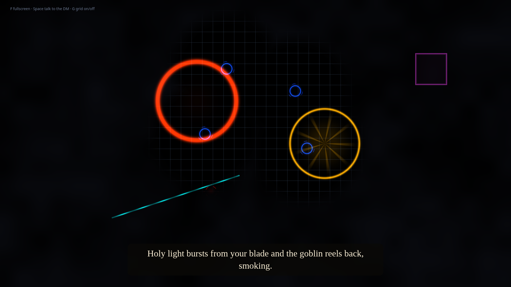

# Lonely Dungeon Master

Play D&D at a real table when nobody else can make it. A webcam above the table tracks your miniatures, a small projector draws the battle grid and spell effects onto the table, and an AI Dungeon Master runs the game out loud.

**Website:** https://zackfairsldrfrst.github.io/lonely-dungeon-master/



## What it does

- **Tracks miniatures.** Each mini wears a small printed tag (an ArUco marker, a square code like a tiny QR code). The camera reads the tags 5 times a second and knows which grid square every mini is on.
- **Projects onto the table.** A blue glowing ring under each hero, a red target aura under each monster, a 1-inch grid, and fog of war that only clears around your heroes.
- **Runs the game.** Say "Hey DM, I swing at the goblin." The DM gets your words, every mini's position and a camera snapshot, follows 5th Edition rules, and answers with narration plus effects drawn on the exact squares.
- **Talks back.** Narration is spoken aloud (ElevenLabs, Piper, or your computer's built-in voice) while the effects play.

## What you need

- A USB webcam, mounted looking straight down at the table
- A projector pointed at the same area (any small one works)
- A computer with Python 3.10+ and a microphone
- A printer for the tags
- An AI model: an **OpenRouter key** (easiest, any model) or **Ollama** (free, runs offline)

## Setup

```bash
git clone https://github.com/ZackFairSldrFrst/lonely-dungeon-master
cd lonely-dungeon-master
pip install -r requirements.txt
```

Linux also needs the PortAudio sound library for the microphone: `sudo apt install libportaudio2` (and `espeak-ng` for the built-in voice).

### Add your AI key

Make a file called `.env` next to `main.py`:

```
OPENROUTER_API_KEY=your-key-here
```

Get a key at [openrouter.ai/keys](https://openrouter.ai/keys). That's the only key you need. The `.env` file is ignored by git, so it never gets uploaded. Keys are never read from `config.yaml`.

Other options, set with `ai.provider` in `config.yaml`:

| Provider | Key | Notes |
|---|---|---|
| `openrouter` (default) | `OPENROUTER_API_KEY` | Any model. Default `google/gemini-3.8-flash` is fast and cheap; `anthropic/claude-sonnet-5.5` tells richer stories. |
| `anthropic` | `ANTHROPIC_API_KEY` | Direct to Claude. |
| `openai` | `OPENAI_API_KEY` | Direct to OpenAI (`gpt-4o`). |
| `ollama` | none | Local and free. `ollama pull llama3.2-vision` first. |

Speech recognition runs locally by default (faster-whisper, no key). Set `voice.stt: openai` to use the Whisper API instead.

## Play

```bash
python main.py --mode markers     # 1. writes marker_sheet.png. Print it, stick a tag on each mini.
python main.py --mode calibrate   # 2. lines up camera and projector (once per setup)
python main.py --mode run         # 3. play
```

1. **Markers.** Tags in `config.yaml` under `entities` get printed with their names. Each tag should be about 0.75 to 1 inch wide. Add your own: `45: { label: Dragon, role: monster }`.
2. **Calibrate.** Clear the table. A window opens on the projector with four green dots. The app finds them in the camera image, waits until they're steady, and saves `calibration_matrix.json`. If it can't find them, dim the room or adjust `calibration_hsv_low/high`.
3. **Run.** Open the printed link (default `http://127.0.0.1:8765`) in a browser on the projector screen and press **F** for fullscreen.

Talking to the DM:

- Say **"Hey DM"** followed by what you do.
- Or press **Space** on the projector page, then speak (no "Hey DM" needed).
- Or type into the terminal and press Enter. An empty Enter means "listen now".
- Or send text from anywhere: `curl -X POST localhost:8765/api/command -H 'content-type: application/json' -d '{"text":"I open the door"}'`

Keys on the projector page: **F** fullscreen, **Space** talk, **G** grid on/off.

### Try it without a camera

```bash
python main.py --mode demo --no-voice
```

Pretend miniatures walk in circles so you can see the projector display and talk to the DM by typing.

## Tuning

- **Grid squares the wrong size?** Measure one projected square with a ruler, then set `projector.pixels_per_inch = current * (1 / measured_inches)`.
- **Minis flicker when a hand passes over?** Raise `vision.lost_timeout_s`.
- **Mic triggers on background noise?** Raise `voice.silence_threshold`.
- **See further through the fog?** Raise `vision.fog_radius_cells`.

## How it fits together

```
webcam ──> core/vision/tracker.py ──(5 per second)──┐
                                                    ├──> main.py (FastAPI + WebSocket) ──> frontend (three.js on the projector)
mic ──> core/audio/voice_service.py ──> core/ai/dm_agent.py ──┘                         └──> spoken narration
```

| File | Job |
|---|---|
| `main.py` | Server. Starts tracking, voice, and the DM; streams everything to the projector page. |
| `core/vision/calibration.py` | Green-dot calibration, `transform_point(cam_x, cam_y)` from camera pixels to projector pixels. |
| `core/vision/tracker.py` | Finds tags, maps them to grid squares, demo minis, printable tag sheet. |
| `core/ai/dm_agent.py` | The DM. One interface over OpenRouter, Anthropic, OpenAI, and Ollama. Keeps session history and game state. |
| `core/audio/voice_service.py` | Microphone, "Hey DM" detection, speech-to-text, text-to-speech. |
| `frontend/src/app.js` | Grid, rings, auras, fog of war, spell effects, narration captions. |

The DM always answers in this shape, which the projector turns into effects:

```json
{
  "narration": "The goblin flinches as your blade lights up with holy energy...",
  "grid_effects": [{"type": "spell_aura", "x": 5, "y": 8, "radius": 2, "color": "gold"}],
  "state_updates": {"monster_1_hp": 12}
}
```

Effect types: `spell_aura`, `area_burst`, `highlight`, `line` (with `x2`, `y2`), `darkness`.

The projector page works without a build step (three.js loads from a CDN). For a table with no internet, run `npm install && npm run build` once; the server then serves the bundled copy.

## Tests

```bash
python -m pytest tests     # or: python tests/test_core.py
```

Checks calibration math on a synthetic camera view, tag detection and grid snapping, DM reply parsing, and "Hey DM" matching. No keys or hardware needed.

## License

MIT. Not affiliated with Wizards of the Coast. Dungeons & Dragons is their trademark.
